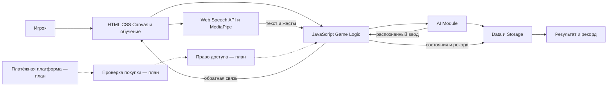

# Архитектура Tower 404

Требуемая цепочка лабораторной: User → Interface → Game Logic → AI Module → Data/Storage → Result.

Цепочка является представлением для лабораторной. В реальном времени распознавание получает ввод интерфейса и возвращает команду игровой логике, а логика обновляет интерфейс. AI Module — интеграция внешних моделей речи и жестов с разбором команды; собственная модель не обучалась. Прогноз загрузки пока алгоритмический, решение о модели выделено в W25.

## Реальные файлы

| Компонент | Файлы и ответственность |
| --- | --- |
| Interface | skyflow/index.html, style.css, game.js — экраны и обработка действий |
| Visuals | tower.js — положение, ракурсы, маршруты и приборы |
| Game Logic | simulation.js — топливо, ресурсы, проверки, события и последствия |
| AI Input | controls.js — Web Speech API, MediaPipe, разбор фраз и устойчивость жестов |
| Narrative | dialogue.js и tutorial.js — реплики и шаги обучения |
| Sound | audio.js — синтез двигателей и сигналов через Web Audio |
| Data | память вкладки — состояние смены; localStorage — рекорд и отметка обучения |
| Quality | skyflow/*.test.cjs и scripts/test.cjs — автоматические проверки |

## Внешние зависимости и границы

Python HTTP server раздаёт файлы и не является игровым backend. Речь может обрабатываться сервисом браузера; библиотека и модель жестов загружаются из CDN, кадры обрабатываются на устройстве. Платёжный сервис, лицензии и серверная проверка права доступа пока отсутствуют. При реализации секреты и доверенное подтверждение покупки должны находиться на стороне сервера/платформы. Реальные платёжные данные не хранятся в браузерном проекте.
